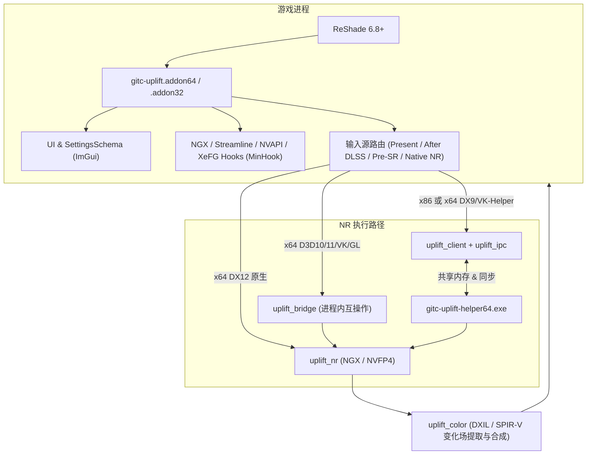

# GITC Uplift 项目分析与架构总结

> 版本：`2.1.0`（`CMakeLists.txt`）
> 目标平台：Windows（x64 / x86）
> 构建系统：CMake + Ninja + MSVC（C++20）+ DXC（HLSL -> DXIL / SPIR-V）

---

## 1. 项目定位与核心能力

**GITC Uplift** 是一个基于 **ReShade Add-on API** 的扩展插件，核心目标是将 **NVIDIA DLSS Neural Rendering (DLSS-NR)** 集成到各类单机游戏中，并提供色彩管理、运动矢量绑定、多 Pass 管线、HUD 剥离/合成、以及 **DLSS / Frame Generation / Reflex / XeFG (XMX)** 增强能力。

### 主要特性
- **全图形 API 覆盖（64 位 & 32 位）**：支持 **DirectX 9 / 10 / 11 / 12**、**Vulkan**（含 DXVK）、**OpenGL**。
- **双架构运行模型**：
  - **64 位原生 / 进程内桥接**：DX12 原生执行 NR；DX10/11、Vulkan、OpenGL 通过进程内桥接（Bridge）或在需要时走 Helper；DX9 通过独立的 64 位辅助进程 `gitc-uplift-helper64.exe` 执行。
  - **32 位跨进程代理**：`gitc-uplift.addon32` 不包含 NGX/D3D12 NR 代码，通过共享内存控制块与同步原语将渲染帧交由 `gitc-uplift-helper64.exe` 在 64 位侧完成 NR 推理。
- **多阶段介入点（NR Stage）**：
  - **Present**：通用后处理阶段，适配所有游戏。
  - **After DLSS / Before Upscaling**：深入游戏帧内管线（DLSS-SR 前后、HUD 之前）。
  - **Native DLSS-NR Replace / After**：接管或增强游戏原生的 DLSS-NR 调用；接管要求当前 Color 和 Output 的有效区域尺寸一致，不负责两者之间的缩放。
- **多模型与推理后端**：
  - 支持标准 NVIDIA `nvngx_dlssnr.dll`（310.8 Legacy `honest_tench`、310.9.16 `Small FP8` / `compat-fp16` 等）。
  - 集成移植的 **NVFP4 / 4-bit NR** 模块（`NrNvfp4` / `NrSwin4` / `NrNet4` / `NrFfnV2` / `NrFp8`，CUDA-on-D3D12）。
  - 集成移植的 **XMX 帧生成模式**（源自 `MFGAdaUnlock-RenoDx`，利用 Intel XeFG + XeLL 在 `nvngx_dlssg.dll` 的 `EvaluateFeature` 内生成帧，支持 Ada/非原生硬件解锁）。
- **一致性色彩与变化场（Change-field）管线**：
  - 支持 sRGB、Scene-linear BT.709、PQ、scRGB、scRGB-nl 等色彩空间。
  - 统一“曝光测光 → 编码/降采样 → NR 推理 → 变化场提取与稳定 → Edge-aware / Classic 上采样合成”流程；单 Pass 时直接复用模型纹理 A 中的 FP16 输入以减少重算开销。
  - 支持 **Keep faces**（人脸保护双生 Pass）、**Auto Exposure**、**Look Shaping**（多频带调色）以及基于 Streamline Tag 的 **HUD-less / UI 修正**。
- **ReShade 覆盖层 UI（双语）**：内置独立 ImGui 上下文，支持 **English** 与 **简体中文**，配置持久化至 `ReShade.ini`。

---

## 2. 仓库目录结构

```text
GITC-Uplift/
├── CMakeLists.txt          # 核心构建配置（按 x64 / x86 分支构建不同产物与静态库）
├── CMakePresets.json       # Ninja 预设：debug / release / debug-x86 / release-x86
├── build.cmd               # 一键构建脚本（自动定位 VS 工具链并拉取依赖）
├── fx/                     # 可选 ReShade Effect（Uplift.fx、UpliftMask.fx）
├── shaders/                # HLSL 计算/顶点/像素着色器（编译为 DXIL 与 SPIR-V 头文件）
├── src/
│   ├── addon.cpp           # x64 Add-on 入口（gitc-uplift.addon64）
│   ├── addon32.cpp         # x86 Add-on 入口（gitc-uplift.addon32）
│   ├── addon/              # ReShade 事件宿主、FG/DLSS/Reflex Hook、HUD/Swapchain 管理
│   ├── bridge/             # 跨 API 桥接层（D3D10/11/12、GL、Vulkan -> D3D12 NR）
│   ├── client/             # 跨进程客户端（32 位及 x64 DX9/部分 VK 路由至 Helper）
│   ├── helper/             # 64 位独立推理进程（gitc-uplift-helper64.exe）
│   ├── ipc/                # 共享内存控制块、配置文本序列化、Helper 启动器
│   ├── nr/                 # NVIDIA NGX / DLSS-NR 封装、特征管理、时间轴与显存预算
│   ├── nvfp4/              # 4-bit / FP8 神经渲染网络实现（CUDA-on-D3D12）
│   ├── ngx_hooks/          # MinHook 拦截 NGX 参数、DLSS 捕获与帧生成控制
│   ├── xmx/                # Intel XeFG/XeLL 帧生成宿主、Hook 与 vendor 移植层
│   ├── color/              # 色彩编码转换、D3D12/Vulkan 色彩管线与 HUD 合成器
│   ├── look/               # Look 数学计算与金字塔塑形
│   ├── sources/            # 各阶段输入源（Present / After DLSS / Pre-SR / 曝光测光）
│   ├── vk/ & src/gl/       # 无 ReShade/D3D12 依赖的原生 Vulkan 与 OpenGL 互操作层
│   ├── state/              # 计算状态阴影跟踪
│   ├── ui/                 # ImGui 面板、本地化、SettingSchema 配置中心
│   └── text/               # 提示与状态文案
├── tools/                  # 回归测试工具、XMX 资源提取脚本、UI 预览器
├── docs/                   # 架构/移植/优化/测试专项文档
└── third_party/_deps/      # 自动拉取的外部依赖（ReShade、ImGui、MinHook、Streamline、NGX、XeSS、MFGUnlocker）
```

---

## 3. 核心架构与模块交互



### 关键模块职责
1. **构建产物划分（`CMakeLists.txt`）**：
   - **x64 半区**：生成 `gitc-uplift.addon64` 与 `gitc-uplift-helper64.exe`，包含完整 `uplift_nr`、`uplift_color`、`uplift_sources`、`uplift_ngx_hooks`、`uplift_xmx`、`uplift_bridge`、`uplift_client`。
   - **x86 半区**：仅生成 `gitc-uplift.addon32`（链接 `uplift_ui32`、`uplift_client`、`uplift_ipc`、`uplift_vk`、`uplift_gl`、`uplift_panel`），不含任何 NGX、Shader 编译或 D3D12 NR 管线代码；通过 `UPLIFT_BUILD_ID` 校验与 64 位 Helper 版本严格匹配。
2. **Shader 编译管线**：
   - 使用 Windows SDK 的 `dxc.exe` 将 `shaders/*.hlsl` 编译为 **DXIL** 头文件（用于 D3D12）。
   - 使用 Vulkan SDK 的 `dxc.exe`（`-spirv`）将同源 HLSL 编译为 **SPIR-V** 头文件（`encode_vk_*`、`decode_vk_*`、`meter_vk_*`、`hud_compose_vk_*` 等，按纹理格式生成变体）。
3. **Hook 与生命周期安全**：
   - `minhook_once` 确保进程内 MinHook 仅初始化一次，供 NGX Hook、Vulkan `vkCreateDevice` Hook、Streamline `slGetFeatureFunction`、NVAPI Reflex/DRS 覆盖及 XMX Hook 共用。
   - `removal_latch` 提供崩溃保护门闩（如 XMX 连续 3 次未正常退出则在下次启动自动关闭）。
4. **上游移植与契约约束（见 `AGENTS.md` 与 `docs/`）**：
   - `src/xmx/vendor/` 与 `src/xmx/generator.hpp` 严格保持与 `MFGAdaUnlock-RenoDx` 的 ABI 字节级一致（含 `static_assert` 与固定 RVA/Timestamp）。
   - `src/nvfp4/` 对齐 `OptiScaler-DLSSNR-PreSR-Multipass`，并在每次评估前执行权重完整性校验（`SetComplete`）。

---

## 4. 构建与测试指南

### 环境依赖
- **Visual Studio**（含 Desktop development with C++ 工作负载，MSVC + Ninja）
- **Windows SDK**（提供 DXIL 版 `dxc.exe`）
- **Vulkan SDK**（环境变量 `VULKAN_SDK`，提供头文件与 SPIR-V 版 `dxc.exe`）
- **Python 3**（用于 `tools/prepare_xemfg_inputs.py` 与 `tools/generate_xess_programs.py`）
- **PowerShell 7 (`pwsh`)**

### 常用构建命令（仓库根目录）
```powershell
# 构建 64 位 Release（含 gitc-uplift.addon64、gitc-uplift-helper64.exe 与所有着色器）
.\build.cmd release

# 构建 64 位 Debug
.\build.cmd debug

# 构建 32 位 Release（gitc-uplift.addon32）
.\build.cmd release-x86
```
> **注意**：由于 MSVC 本地化 `/showIncludes` 的限制，仅修改 `.hpp` / `.hlsli` 文件时需手动 `touch` 同目标下的一个 `.cpp` 文件再编译。

### 独立回归测试与探测工具（`tools/`）
在完成 `release` 构建后，可在 VS x64 开发者环境中按需编译以下独立目标（均标记为 `EXCLUDE_FROM_ALL`）：
- `uplift_nr_regression` / `uplift_vk_nr_regression`：D3D12 与 Vulkan NR 管线回归测试
- `uplift_native_nr_regression` / `uplift_native_nr_handle_probe`：原生 DLSS-NR 替换与同句柄动态尺寸探测
- `uplift_fg_hud_inputs_regression` / `uplift_hud_present_regression`：HUD-less 输入与合成测试
- `uplift_nvfp4_scratch_regression` / `uplift_nvfp4_failure_regression`：NVFP4 显存与容错测试
- `uplift_helper_protocol_regression`：Helper 跨进程 IPC 协议测试

---

## 5. 现有专项文档索引

- [docs/xmx-upstream-port.md](xmx-upstream-port.md) — XMX（`MFGAdaUnlock-RenoDx`）上游移植记录
- [docs/xefg-input-sizes.md](xefg-input-sizes.md) — XeFG 输入尺寸与帧生成准入条件
- [docs/nvfp4-upstream-port.md](nvfp4-upstream-port.md) — NVFP4（`OptiScaler-DLSSNR-PreSR-Multipass`）上游移植记录
- [docs/native-nr-replacement-testing.md](native-nr-replacement-testing.md) — 原生 DLSS-NR 替换与同句柄探测指南
- [docs/hud-inputs-only.md](hud-inputs-only.md) — 实验性“仅 HUD 输入”模式说明
- [docs/nr-pipeline-optimization-2026-11-21.md](nr-pipeline-optimization-2026-11-21.md) — NR 管线性能优化记录
- [docs/code-cleanup-2026-11-22.md](code-cleanup-2026-11-22.md) — 代码清理记录
